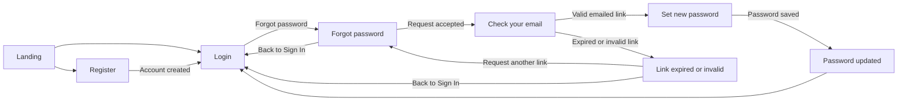

# Hope, Inc. ERP Authentication Wireframes

Low-fidelity, grayscale wireframes for desktop and mobile. Controls and copy are shown as text; no color, imagery, or decorative styling is implied.

## Design Basis and Assumptions

- Reuse the current Hope, Inc. prototype's centered authentication dialog, Hope brand label, single-column form, and compact form width. On desktop, center the form in a quiet page shell; on mobile, use the same order with 16 px side gutters and a vertically scrollable viewport.
- Keep the existing neutral typography and spacing conventions, but render all surfaces, borders, and text in grayscale at this wireframe stage.
- Assume Supabase Auth sends a time-limited, one-use email reset link. The application validates the link before showing the new-password form.
- Assume password policy is at least 12 characters, with lowercase, uppercase, number, and symbol. Confirm this policy against the backend before implementation.
- Assign the `User` role on the server for every registration. Never accept a role from the registration form.
- On login, return the same generic message for unknown email and wrong password. Show the blocked-account message only after valid credentials are verified, so it does not reveal account existence to an unauthenticated person.

## Flow



## 1. Login

### Desktop, default (1440 px)

```text
+--------------------------------------------------------------------------+
| Hope, Inc. ERP [1]                                                       |
|                                                                          |
|                    +----------------------------------+                  |
|                    | Sign In                          |                  |
|                    | Use your Hope, Inc. account.     |                  |
|                    |                                  |                  |
|                    | Email address                    |                  |
|                    | [ name@example.com             ] |                  |
|                    | Password                         |                  |
|                    | [ ••••••••••••              ][Show]|                 |
|                    | [ ] Remember me                  |                  |
|                    |                 Forgot password? [2]|                 |
|                    | [ Sign In                      ] |                  |
|                    | ------------ or ------------   |                  |
|                    | [ Continue with Google       ] |                  |
|                    | New to Hope, Inc.? Register [3]|                 |
|                    +----------------------------------+                  |
|                                                                          |
+--------------------------------------------------------------------------+
```

### Mobile, default (390 px)

```text
+--------------------------------------+
| Hope, Inc. ERP [1]                   |
|                                      |
| +----------------------------------+ |
| | Sign In                          | |
| | Use your Hope, Inc. account.     | |
| |                                  | |
| | Email address                    | |
| | [ name@example.com             ] | |
| | Password                         | |
| | [ ••••••••••••              ][Show]|
| | [ ] Remember me                  | |
| | Forgot password? [2]             | |
| | [ Sign In                      ] | |
| | ------------ or ------------     | |
| | [ Continue with Google       ] | |
| | New to Hope, Inc.? Register [3] | |
| +----------------------------------+ |
+--------------------------------------+
```

### Login states

| State | Visible result |
| --- | --- |
| Default | Empty email and password fields; Remember me unchecked. |
| Field error | Missing email: `Enter your email address.` Invalid email format: `Enter a valid email address.` Missing password: `Enter your password.` Place each message directly below its field. |
| Authentication error | `Email or password is incorrect.` Use this exact message for an unknown email and a wrong password. Keep the entered email; clear the password. |
| Blocked account | After credentials are verified: `This account can't sign in right now. Contact your administrator for help.` Do not reveal block status before valid credentials. |
| Loading | Disable form actions; change button to `Signing in...`; announce `Signing in.` Keep focus on the submit button. |
| Success | On valid, active account: continue to the authorized dashboard. No success toast is required on the login screen. |
| Google error | `Google sign-in couldn't be completed. Try again or use your email.` |

### Login callouts

1. Brand returns to the landing page. Keep the page a neutral, centered form; desktop uses whitespace, mobile uses a single full-width column.
2. Forgot password opens the email request screen. Keep it adjacent to the password area and keyboard reachable.
3. Register opens the registration screen. Google is an alternate action, not a required step.

## 2. Register

### Desktop, default (1440 px)

```text
+--------------------------------------------------------------------------+
| Hope, Inc. ERP [1]                                                       |
|                                                                          |
|                    +----------------------------------+                  |
|                    | Create account                   |                  |
|                    | New accounts are created as User.|                  |
|                    |                                  |                  |
|                    | First name                       |                  |
|                    | [ First name                   ] |                  |
|                    | Last name                        |                  |
|                    | [ Last name                    ] |                  |
|                    | Email address                    |                  |
|                    | [ name@example.com             ] |                  |
|                    | [ Register                     ] |                  |
|                    | ------------ or ------------   |                  |
|                    | [ Continue with Google       ] |                  |
|                    | Already registered? Sign In [2] |                  |
|                    +----------------------------------+                  |
+--------------------------------------------------------------------------+
```

### Mobile, default (390 px)

```text
+--------------------------------------+
| Hope, Inc. ERP [1]                   |
| +----------------------------------+ |
| | Create account                   | |
| | New accounts are created as User.| |
| | First name                       | |
| | [ First name                   ] | |
| | Last name                        | |
| | [ Last name                    ] | |
| | Email address                    | |
| | [ name@example.com             ] | |
| | [ Register                     ] | |
| | ------------ or ------------     | |
| | [ Continue with Google       ] | |
| | Already registered? Sign In [2] | |
| +----------------------------------+ |
+--------------------------------------+
```

### Registration states

| State | Visible result |
| --- | --- |
| Default | All fields empty. The role note is visible above the form. |
| Field error | First name: `Enter your first name.` Last name: `Enter your last name.` Email missing: `Enter your email address.` Invalid email: `Enter a valid email address.` Show each message under its field. |
| Create error | `We couldn't create an account with those details. Check your information or try signing in.` Do not disclose whether an email is registered. |
| Loading | Disable actions; change button to `Creating account...`; announce `Creating your account.` Keep focus on the submit button. |
| Success | `Account created. Follow any verification prompt, then sign in.` Show a `Go to Sign In` action. Server assigns role `User`. |
| Google error | `Google sign-up couldn't be completed. Try again or use your email.` |

### Registration callouts

1. Keep the `User` role note visible and non-editable; role assignment is server-side.
2. The Sign In link returns to Login without clearing the route context unexpectedly.

## 3. Forgot Password

### Desktop, default (1440 px)

```text
+--------------------------------------------------------------------------+
| Hope, Inc. ERP [1]                                                       |
|                    +----------------------------------+                  |
|                    | Forgot password?                 |                  |
|                    | Enter your email to request a    |                  |
|                    | password reset link.             |                  |
|                    | Email address                    |                  |
|                    | [ name@example.com             ] |                  |
|                    | [ Send Reset Link              ] |                  |
|                    | [ Back to Sign In              ] |                  |
|                    +----------------------------------+                  |
+--------------------------------------------------------------------------+
```

### Mobile, default (390 px)

```text
+--------------------------------------+
| Hope, Inc. ERP [1]                   |
| +----------------------------------+ |
| | Forgot password?                 | |
| | Enter your email to request a    | |
| | password reset link.             | |
| | Email address                    | |
| | [ name@example.com             ] | |
| | [ Send Reset Link              ] | |
| | [ Back to Sign In              ] | |
| +----------------------------------+ |
+--------------------------------------+
```

### Forgot-password states

| State | Visible result |
| --- | --- |
| Default | Empty email field. Explain that a reset link can be requested without saying whether an account exists. |
| Field error | Missing email: `Enter your email address.` Invalid email: `Enter a valid email address.` |
| Request error | `We couldn't process that request. Try again.` Do not indicate whether the address is registered. |
| Loading | Disable submit; button reads `Sending...`; announce `Sending reset link.` Keep focus on the button. |
| Success | Navigate to the Check Your Email confirmation screen with neutral copy. |

### Forgot-password callout

1. Always show the same confirmation after a syntactically valid request, whether or not an account matches the address.

## 4. Check Your Email Confirmation

### Desktop, confirmation (1440 px)

```text
+--------------------------------------------------------------------------+
| Hope, Inc. ERP [1]                                                       |
|                    +----------------------------------+                  |
|                    | Check your email                 |                  |
|                    | If an account matches that email,|                  |
|                    | a reset link will arrive shortly.|                  |
|                    |                                  |                  |
|                    | Didn't receive it?               |
|                    | [ Send another link            ] |                  |
|                    | [ Back to Sign In              ] |                  |
|                    +----------------------------------+                  |
+--------------------------------------------------------------------------+
```

### Mobile, confirmation (390 px)

```text
+--------------------------------------+
| Hope, Inc. ERP [1]                   |
| +----------------------------------+ |
| | Check your email                 | |
| | If an account matches that email,| |
| | a reset link will arrive shortly.| |
| | Didn't receive it?               | |
| | [ Send another link            ] | |
| | [ Back to Sign In              ] | |
| +----------------------------------+ |
+--------------------------------------+
```

### Confirmation states

| State | Visible result |
| --- | --- |
| Default / success | The neutral confirmation above is the success state. Do not display a user-existence signal or echo the submitted address. |
| Resend error | `We couldn't process that request. Try again.` Keep the same confirmation heading and body. |
| Loading | Resend button reads `Sending...`, is disabled, and announces `Sending another reset link.` |
| Resend success | Keep the same neutral confirmation copy; announce `If an account matches that email, a reset link will arrive shortly.` |

### Confirmation callout

1. Resend uses the same server behavior and neutral response as the initial request. Apply server-side rate limits; do not reveal delivery details.

## 5. Set / Reset New Password

### Desktop, default (1440 px)

```text
+--------------------------------------------------------------------------+
| Hope, Inc. ERP [1]                                                       |
|                    +----------------------------------+                  |
|                    | Set a new password               |                  |
|                    | New password                     |                  |
|                    | [ ••••••••••••              ][Show]|                 |
|                    | Password must have:              |                  |
|                    | [ ] 12 characters or more        |                  |
|                    | [ ] A lowercase letter           |                  |
|                    | [ ] An uppercase letter           |                  |
|                    | [ ] A number                      |                  |
|                    | [ ] A symbol                      |                  |
|                    | Confirm password                  |                  |
|                    | [ ••••••••••••              ][Show]|                 |
|                    | [ Save Password                ] |                  |
|                    +----------------------------------+                  |
+--------------------------------------------------------------------------+
```

### Mobile, default (390 px)

```text
+--------------------------------------+
| Hope, Inc. ERP [1]                   |
| +----------------------------------+ |
| | Set a new password               | |
| | New password                     | |
| | [ ••••••••••••              ][Show]|
| | Password must have:              | |
| | [ ] 12 characters or more        | |
| | [ ] A lowercase letter           | |
| | [ ] An uppercase letter           | |
| | [ ] A number                      | |
| | [ ] A symbol                      | |
| | Confirm password                  | |
| | [ ••••••••••••              ][Show]|
| | [ Save Password                ] | |
| +----------------------------------+ |
+--------------------------------------+
```

### New-password states

| State | Visible result |
| --- | --- |
| Default | Password fields empty; all five rules unchecked. Checklist updates as the user types and is announced politely without moving focus. |
| Field error | Missing password: `Enter a new password.` Missing confirmation: `Confirm your new password.` Too short: `Use at least 12 characters.` Missing lowercase: `Add a lowercase letter.` Missing uppercase: `Add an uppercase letter.` Missing number: `Add a number.` Missing symbol: `Add a symbol.` Mismatch: `Passwords don't match.` |
| Save error | For a valid but unusable/expired token, show the Expired or Invalid Link screen. For other save failures: `We couldn't save your password. Try again or request a new reset link.` |
| Loading | Disable both fields and actions; button reads `Saving...`; announce `Saving your new password.` Keep focus on the button. |
| Success | Navigate to Password Updated. Never display or echo either password. |

### New-password callouts

1. Show/hide buttons toggle only their adjacent input and update their accessible name between `Show password` and `Hide password` (and the same for confirmation).
2. Each checklist item changes from `[ ]` to `[x]` when its rule is met. Use text/symbol plus accessible status, not color alone.
3. Disable Save until all rules pass and both values match. Server must enforce the same policy.

## 6. Password Updated

### Desktop, success (1440 px)

```text
+--------------------------------------------------------------------------+
| Hope, Inc. ERP [1]                                                       |
|                    +----------------------------------+                  |
|                    | Password updated                 |                  |
|                    | Your password has been changed.  |                  |
|                    | Sign in with your new password.   |                  |
|                    | [ Return to Login             ] |                  |
|                    +----------------------------------+                  |
+--------------------------------------------------------------------------+
```

### Mobile, success (390 px)

```text
+--------------------------------------+
| Hope, Inc. ERP [1]                   |
| +----------------------------------+ |
| | Password updated                 | |
| | Your password has been changed.  | |
| | Sign in with your new password.   | |
| | [ Return to Login             ] | |
| +----------------------------------+ |
+--------------------------------------+
```

### Password-updated states

| State | Visible result |
| --- | --- |
| Default / success | Show the confirmation and one `Return to Login` action. |
| Error | If the update did not persist, remain on the form and show `We couldn't save your password. Try again or request a new reset link.` |
| Loading | During route transition, announce `Password updated. Returning to sign in.` Keep the success heading available. |

### Password-updated callout

1. Return to Login clears the reset token from the URL/state and moves focus to the Login heading or email field.

## 7. Expired or Invalid Reset Link

### Desktop, error (1440 px)

```text
+--------------------------------------------------------------------------+
| Hope, Inc. ERP [1]                                                       |
|                    +----------------------------------+                  |
|                    | Reset link unavailable           |
|                    | This password-reset link is      |
|                    | invalid or has expired.          |
|                    |                                  |
|                    | [ Request a New Reset Link    ] |                  |
|                    | [ Back to Sign In              ] |                  |
|                    +----------------------------------+                  |
+--------------------------------------------------------------------------+
```

### Mobile, error (390 px)

```text
+--------------------------------------+
| Hope, Inc. ERP [1]                   |
| +----------------------------------+ |
| | Reset link unavailable           | |
| | This password-reset link is      | |
| | invalid or has expired.          | |
| | [ Request a New Reset Link    ] | |
| | [ Back to Sign In              ] | |
| +----------------------------------+ |
+--------------------------------------+
```

### Invalid-link states

| State | Visible result |
| --- | --- |
| Default / error | Show the invalid/expired message. Never render the set-password form for an invalid token. |
| Request error | `We couldn't process that request. Try again.` Keep both recovery actions available. |
| Loading | Request button reads `Sending...`; announce `Sending reset link.` |
| Success | After the user enters an email on the Forgot Password screen, show Check Your Email with its neutral confirmation. |

### Invalid-link callouts

1. `Request a New Reset Link` routes to Forgot Password; the user enters an email there. Do not infer or display the account email from the token.
2. `Back to Sign In` routes to Login without consuming or exposing the invalid token.

## Blocked Account Sign-In

After the user supplies a valid password and the server confirms the account is blocked, display: **“This account can't sign in right now. Contact your administrator for help.”** Before valid credentials are established, use only the generic Login error. This avoids revealing account existence or block status to someone who does not know the password.

## Keyboard Order and Initial Focus

Focus moves to the heading on status/confirmation screens and to the first field on form screens. On failed submission, focus the first invalid field and associate its inline message with `aria-describedby`; announce a form-level server error through a polite live region. Loading does not move focus. Password-rule updates are polite live announcements and are not tab stops.

| Screen | Focus when opened | Tab order |
| --- | --- | --- |
| Login | Email address | Email, Password, Show/Hide password, Remember me, Forgot password, Sign In, Continue with Google, Register. |
| Register | First name | First name, Last name, Email address, Register, Continue with Google, Sign In. |
| Forgot Password | Email address | Email address, Send Reset Link, Back to Sign In. |
| Check Your Email | Heading `Check your email` | Send another link, Back to Sign In. |
| Set New Password | New password | New password, Show/Hide password, Confirm password, Show/Hide confirmation, Save Password. Checklist is not focusable. |
| Password Updated | Heading `Password updated` | Return to Login. |
| Reset Link Unavailable | Heading `Reset link unavailable` | Request a New Reset Link, Back to Sign In. |

All links and buttons have visible keyboard focus. Enter submits a form when appropriate; Space activates buttons/checkboxes. Toggle controls expose `Show password` / `Hide password` names and do not submit the form.

## Microcopy Inventory

All visible labels, placeholders, helper text, button names, and validation/server messages are listed below. Password placeholders represent masked input, not literal placeholder copy.

| Screen | Type | Exact copy |
| --- | --- | --- |
| Shared | Brand | `Hope, Inc. ERP` |
| Login | Heading | `Sign In` |
| Login | Helper | `Use your Hope, Inc. account.` |
| Login | Label | `Email address` |
| Login | Placeholder | `name@example.com` |
| Login | Label | `Password` |
| Login | Placeholder | Empty masked password field; do not use placeholder text as the label. |
| Login | Toggle | `Show password` / `Hide password` |
| Login | Checkbox | `Remember me` |
| Login | Link | `Forgot password?` |
| Login | Button | `Sign In` |
| Login | Divider | `or` |
| Login | Button | `Continue with Google` |
| Login | Link text | `New to Hope, Inc.? Register` |
| Login | Required error | `Enter your email address.` |
| Login | Email error | `Enter a valid email address.` |
| Login | Required error | `Enter your password.` |
| Login | Authentication error | `Email or password is incorrect.` |
| Login | Blocked account | `This account can't sign in right now. Contact your administrator for help.` |
| Login | Loading | `Signing in...` / announcement: `Signing in.` |
| Login | Google error | `Google sign-in couldn't be completed. Try again or use your email.` |
| Register | Heading | `Create account` |
| Register | Role helper | `New accounts are created as User.` |
| Register | Label | `First name` |
| Register | Placeholder | `First name` |
| Register | Label | `Last name` |
| Register | Placeholder | `Last name` |
| Register | Label | `Email address` |
| Register | Placeholder | `name@example.com` |
| Register | Button | `Register` |
| Register | Divider | `or` |
| Register | Button | `Continue with Google` |
| Register | Link text | `Already registered? Sign In` |
| Register | Required error | `Enter your first name.` |
| Register | Required error | `Enter your last name.` |
| Register | Required error | `Enter your email address.` |
| Register | Email error | `Enter a valid email address.` |
| Register | Create error | `We couldn't create an account with those details. Check your information or try signing in.` |
| Register | Loading | `Creating account...` / announcement: `Creating your account.` |
| Register | Success | `Account created. Follow any verification prompt, then sign in.` |
| Register | Success action | `Go to Sign In` |
| Register | Google error | `Google sign-up couldn't be completed. Try again or use your email.` |
| Forgot Password | Heading | `Forgot password?` |
| Forgot Password | Helper | `Enter your email to request a password reset link.` |
| Forgot Password | Label | `Email address` |
| Forgot Password | Placeholder | `name@example.com` |
| Forgot Password | Button | `Send Reset Link` |
| Forgot Password | Link/button | `Back to Sign In` |
| Forgot Password | Required error | `Enter your email address.` |
| Forgot Password | Email error | `Enter a valid email address.` |
| Forgot Password | Request error | `We couldn't process that request. Try again.` |
| Forgot Password | Loading | `Sending...` / announcement: `Sending reset link.` |
| Check Your Email | Heading | `Check your email` |
| Check Your Email | Neutral confirmation | `If an account matches that email, a reset link will arrive shortly.` |
| Check Your Email | Prompt | `Didn't receive it?` |
| Check Your Email | Button | `Send another link` |
| Check Your Email | Link/button | `Back to Sign In` |
| Check Your Email | Resend error | `We couldn't process that request. Try again.` |
| Check Your Email | Loading | `Sending...` / announcement: `Sending another reset link.` |
| Check Your Email | Resend success | `If an account matches that email, a reset link will arrive shortly.` |
| Set New Password | Heading | `Set a new password` |
| Set New Password | Label | `New password` |
| Set New Password | Placeholder | Empty masked password field; no literal placeholder. |
| Set New Password | Helper | `Password must have:` |
| Set New Password | Rule | `12 characters or more` |
| Set New Password | Rule | `A lowercase letter` |
| Set New Password | Rule | `An uppercase letter` |
| Set New Password | Rule | `A number` |
| Set New Password | Rule | `A symbol` |
| Set New Password | Label | `Confirm password` |
| Set New Password | Placeholder | Empty masked password field; no literal placeholder. |
| Set New Password | Toggle | `Show password` / `Hide password` |
| Set New Password | Toggle | `Show confirmation` / `Hide confirmation` |
| Set New Password | Button | `Save Password` |
| Set New Password | Required error | `Enter a new password.` |
| Set New Password | Required error | `Confirm your new password.` |
| Set New Password | Rule error | `Use at least 12 characters.` |
| Set New Password | Rule error | `Add a lowercase letter.` |
| Set New Password | Rule error | `Add an uppercase letter.` |
| Set New Password | Rule error | `Add a number.` |
| Set New Password | Rule error | `Add a symbol.` |
| Set New Password | Mismatch error | `Passwords don't match.` |
| Set New Password | Save error | `We couldn't save your password. Try again or request a new reset link.` |
| Set New Password | Loading | `Saving...` / announcement: `Saving your new password.` |
| Password Updated | Heading | `Password updated` |
| Password Updated | Confirmation | `Your password has been changed. Sign in with your new password.` |
| Password Updated | Button | `Return to Login` |
| Password Updated | Transition | `Password updated. Returning to sign in.` |
| Reset Link Unavailable | Heading | `Reset link unavailable` |
| Reset Link Unavailable | Error | `This password-reset link is invalid or has expired.` |
| Reset Link Unavailable | Button | `Request a New Reset Link` |
| Reset Link Unavailable | Link/button | `Back to Sign In` |
| Reset Link Unavailable | Request error | `We couldn't process that request. Try again.` |
| Reset Link Unavailable | Loading | `Sending...` / announcement: `Sending reset link.` |