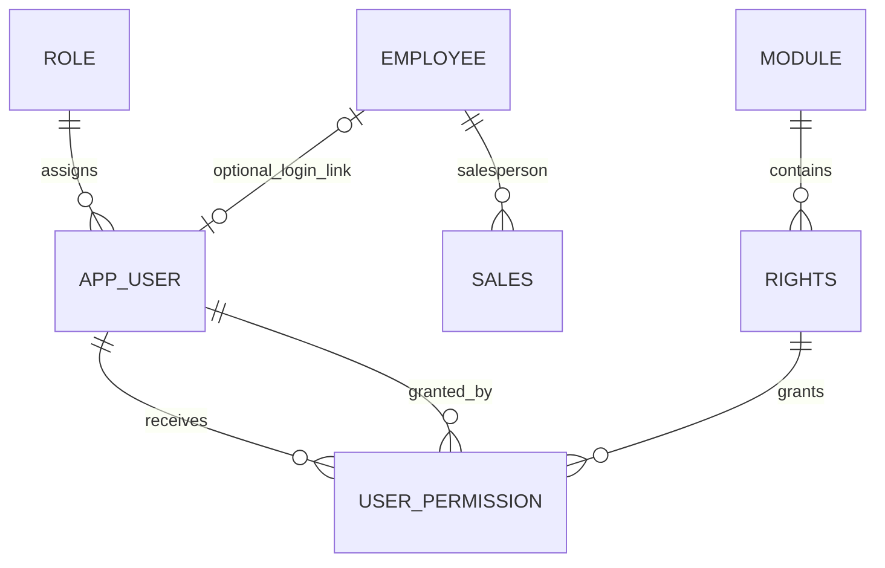

# User-Management Database Design

## Proposed Tables

| Table | Key and relationships | Purpose and behavior |
|---|---|---|
| `role` | Identity primary key; unique name | Seeds Superadmin, Admin, and User. New accounts default to User. |
| `app_user` | Identity primary key; unique lowercase email; role FK; optional unique employee FK | Login identity, password hash, block/lockout state, and latest stamp. |
| `module` | Identity primary key; unique code, name, and sort order | Seeds the five permission modules. |
| `rights` | Identity primary key; unique code; module FK | Seeds the 36 checkbox rights and their UI labels. |
| `user_permission` | Composite primary key `(user_id, right_id)`; user, right, and grantor FKs | Stores explicit grants. Revoke/restore updates status on the same row. |

## ERD Fragment



`SALES.employee_id` (called `empNo` in the legacy guide/script) identifies the salesperson for a transaction. It is not the login identity. `app_user.employee_id` is an optional one-to-one link for staff who have an ERP login; it may be NULL for administrators or other accounts without an employee record. A future audit actor should identify `app_user`, not infer identity from the salesperson on a sale.

## Authorization and Soft Delete

- New `app_user` rows receive the active User role if `role_id` is omitted. Email is trimmed and lowercased before storage; the unique constraint therefore gives case-insensitive uniqueness.
- `password_hash` may be NULL while `must_set_password` is true. The application must create salted bcrypt/Argon2 hashes and must never store plaintext passwords or reset tokens.
- A blocked account keeps its permission rows. The server must reject authentication when `is_blocked` is true; the effective-rights view reports the grants independently of block state.
- Superadmin has every active catalogue right implicitly. Do not insert `user_permission` rows for Superadmin; the view returns `granted = true` for those rights.
- Only an active, unblocked Admin or Superadmin may change permissions. Before permission writes, the authenticated server must set transaction-local `app.user_id` to the verified actor ID. The trigger checks that actor and rejects physical deletes. The application must still authorize every API request, prevent clients from choosing `app.user_id`, and restrict direct database access; the trigger is an additional guard, not a replacement for server authorization.
- Unticking a permission sets its status to Inactive; ticking it again updates the same `(user_id, right_id)` row to Active. The stamp records only the latest operation, so earlier grant/revoke cycles are lost. A separate audit log in Task 6 is required for full history.

## Queries and Verification

At login, query one user's effective rights with:

```sql
SELECT module_code, module_name, right_code, granted, is_blocked
FROM public.v_user_effective_rights
WHERE user_id = $1
ORDER BY module_code, right_code;
```

Inspect the seeded catalogue counts with:

```sql
SELECT module_name, rights_count
FROM public.v_rights_count_by_module
ORDER BY module_code;
```

Expected counts: Customer 3, Product 6, Human Resources 13, Sales 7, Reports 7; total 36. Run `psql -v ON_ERROR_STOP=1 -f db/verification/user_management_verification.sql` after `npm run db:migrate`. It prints the counts and rolls back its temporary account/permission checks; any failed assertion exits non-zero.

The Task 3 migration is forward-only. To roll back during development, recreate the local development database with `npm run db:reset`, then rerun all migrations. Never drop these tables manually in a shared database.