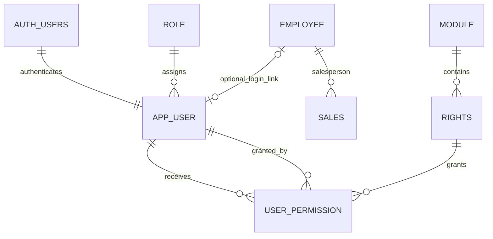

# User-Management Database Design

## Proposed Tables

| Table | Key and relationships | Purpose and behavior |
|---|---|---|
| `role` | Identity primary key; unique name | Seeds Superadmin, Admin, and User. New accounts default to User. |
| `app_user` | BIGINT identity PK; required unique `auth_user_id` UUID FK to Supabase Auth; unique lowercase email; role FK; optional unique employee FK | Application profile, approval/block state, and latest stamp. Supabase Auth owns credentials. |
| `module` | Identity primary key; unique code, name, and sort order | Seeds the five permission modules. |
| `rights` | Identity primary key; unique code; module FK | Seeds the 36 checkbox rights and their UI labels. |
| `user_permission` | Composite primary key `(user_id, right_id)`; user, right, and grantor FKs | Stores explicit grants. Revoke/restore updates status on the same row. |

## ERD Fragment



`auth.users.id` is the Supabase Auth identity linked by `app_user.auth_user_id`; `app_user.id` remains the BIGINT application key. Passwords and reset tokens are managed only by Supabase Auth and are not stored in `app_user`. `approval_status` defaults to `Pending` and allows `Pending`, `Approved`, or `Rejected`; the registration API should create profiles as Pending, `v_user_effective_rights.granted` remains false until approval is Approved, and the server must check approval before granting application access. The stored role name remains exactly `User` (capital U) for new registrations.

`SALES.employee_id` (called `empNo` in the legacy guide/script) identifies the salesperson for a transaction. It is not the login identity. `app_user.employee_id` is an optional one-to-one link for staff who have an ERP login; it may be NULL for administrators or other accounts without an employee record. A future audit actor should identify `app_user`, not infer identity from the salesperson on a sale.

## Authorization and Soft Delete

- New `app_user` rows receive the active `User` role if `role_id` is omitted. Email is trimmed and lowercased before storage; the unique constraint therefore gives case-insensitive uniqueness.
- Supabase Auth validates credentials and manages password/reset lifecycles. `app_user` contains no password or reset-token fields.
- New application profiles default to `approval_status = 'Pending'`; registration endpoints should not grant application access until the state becomes `Approved`.
- A blocked account keeps its permission rows. The server must reject authentication when `is_blocked` is true; the effective-rights view reports the grants independently of block state.
- Superadmin has every active catalogue right implicitly. Do not insert `user_permission` rows for Superadmin; the view returns `granted = true` for those rights.
- Only an active, unblocked Admin or Superadmin may change permissions. Before permission writes, the authenticated server must set transaction-local `app.user_id` to the verified actor ID. The trigger checks that actor and rejects physical deletes. The application must still authorize every API request, prevent clients from choosing `app.user_id`, and restrict direct database access; the trigger is an additional guard, not a replacement for server authorization.
- Unticking a permission sets its status to Inactive; ticking it again updates the same `(user_id, right_id)` row to Active. The stamp records only the latest operation, so earlier grant/revoke cycles are lost. A separate audit log in Task 6 is required for full history.

## Queries and Verification

After Supabase Auth identifies the caller, resolve their profile by `auth_user_id`, then query effective rights by the BIGINT `app_user.id` with:

```sql
SELECT module_code, module_name, right_code, granted, is_blocked, approval_status
FROM public.v_user_effective_rights
WHERE user_id = $1
ORDER BY module_code, right_code;
```

Inspect the seeded catalogue counts with:

```sql
SELECT module_name, rights_count
FROM public.v_rights_count_by_module
ORDER BY module_code;
```

Expected counts: Customer 3, Product 6, Human Resources 13, Sales 7, Reports 7; total 36. CI creates a minimal `auth.users` stub and three UUID fixtures before migration to verify the FK. To run this script against plain local PostgreSQL, create the same stub and fixtures in a disposable database and grant the migration role `USAGE` on schema `auth` plus `REFERENCES` on `auth.users`. Do not create mock Auth identities in a shared or production Supabase project. Then run `psql -v ON_ERROR_STOP=1 -f db/verification/user_management_verification.sql`; it prints the counts and rolls back its temporary app-user/permission checks. Any failed assertion exits non-zero.

The Task 3 migration is forward-only. To roll back during development, recreate the local development database with `npm run db:reset`, then rerun all migrations. Never drop these tables manually in a shared database.